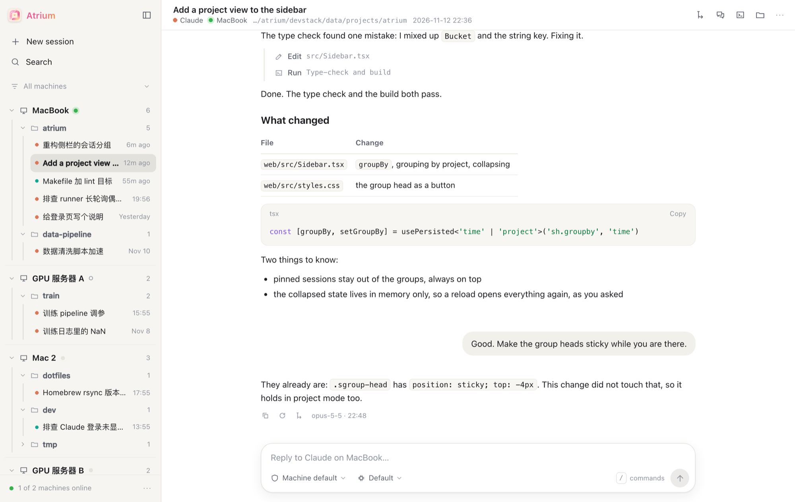
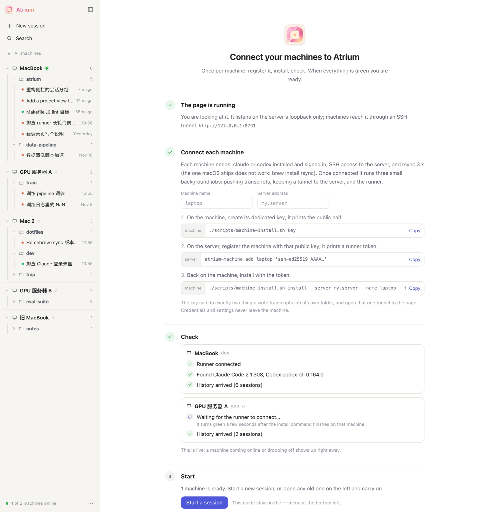

<p align="center">
  
</p>

<h1 align="center">Atrium 中庭</h1>

<p align="center">
  <b>One page for every Claude Code and Codex session, on every machine you use.</b><br>
  Read them, search them, and keep working in them, like a desktop chat app. Self-hosted.
</p>

<p align="center">
  <a href="README.zh-CN.md">中文</a> ·
  <a href="#quick-start">Quick start</a> ·
  <a href="docs/install.md">Install guide</a> ·
  <a href="#how-it-works">How it works</a>
</p>

<p align="center">
  
</p>

## Why

Claude Code and Codex keep each session on the machine where it ran, and each client shows only its own. That is fine with one laptop. It stops being fine with a laptop, a second laptop and a couple of GPU servers:

- **The work is scattered.** Which machine was that conversation on? There is no list of everything and no search across machines.
- **Checking on a long run means SSH.** A training job or a big refactor on a server can only be watched from a terminal on that server.
- **Picking a session up elsewhere is fiddly.** Find the machine, find the session id, `claude --resume`, hope nothing else is writing to it.
- **Hosted dashboards want your transcripts.** They hold your code, your prompts and whatever the agent printed. Those should stay on hardware you control.

Atrium is the fix I wanted: an *atrium* is the open court in the middle of a house that every room opens onto. Every machine opens onto one page. Three things were not negotiable:

1. **The agents stay as they are.** A message sent from Atrium runs `claude` or `codex` on the session's own machine and is appended to the same native transcript. Open the session later in a terminal or the desktop client and it is all there. Nothing is locked in.
2. **Everything stays yours.** Your server or your own computer, your machines, plain files. No account, no cloud service.
3. **Nothing listens on the internet.** The page binds to loopback. Machines reach it through an SSH tunnel made with a key that can do two things and no more.

## What you can do

**See everything**
- Every session from every machine in one sidebar: machine, then working folder, then sessions newest first. Or a flat list by day.
- Full history with tool calls folded into tidy steps, and full-text search across all of it.
- Folders and sessions nobody has touched for seven days fold themselves away, so the list stays about current work.
- Usage on a status bar along the bottom of the window: how much of each agent's plan limit is used and when it resets, and the tokens of the last seven days by day, machine and model. The limits are what the `claude` and `codex` CLIs on your machines last saw; Atrium does not ask the services itself.

**Keep working**
- Type at the bottom of any session. The turn runs on the machine that owns it, output streams back live, and permission requests show up as buttons.
- Start a new session on any connected machine, in any folder: pick a recent one, browse, or type a path.
- Choose the model and reasoning effort from the list that machine's own CLI reports.

**Branch like a chat app**
- Edit an earlier message or try an answer again: the same session goes on from that point, and what it replaced is folded away, one click from being read again.
- Fork from any reply to start a new session from there; the original is left alone.
- Side chat: ask a question next to the conversation. It knows everything said so far, and nothing asked there is written back.
- Type `/` for commands: Atrium's own, plus the slash commands and skills your Claude Code install reports.

**Work on the machine** (off until you turn it on)
- A real terminal on the session's machine, as if you had SSHed in.
- The session's folder as a file tree, with a small editor.

It comes in English and Chinese, as a web page and as a small macOS app.

## Quick start

Download the archive for your system from **[Releases](https://github.com/wx9Songs/atrium/releases)** and unpack it. It holds the hub, the runner and the install scripts, so nothing needs compiling. Each machine needs `claude` and/or `codex` installed and signed in.

| System | Archive |
|---|---|
| Mac, Apple silicon | `atrium-<version>-darwin-arm64.tar.gz` |
| Mac, Intel | `atrium-<version>-darwin-amd64.tar.gz` |
| Linux, x86-64 | `atrium-<version>-linux-amd64.tar.gz` |
| Linux, ARM | `atrium-<version>-linux-arm64.tar.gz` |

To build from source instead you need Go 1.22+ and Node 18+: `make` puts the same files in `bin/`.

### A. Just this computer, no server

Everything runs on your own Mac or Linux desktop and listens on loopback only. No server, no SSH, no account.

```bash
tar -xzf atrium-*-darwin-arm64.tar.gz && cd atrium-*-darwin-arm64
./scripts/local-install.sh install
./scripts/local-install.sh link
```

`install` sets up three small background jobs (the archive, the page, the runner), and `link` opens the page signed in at `http://127.0.0.1:13005`. To remove it all: `./scripts/local-install.sh uninstall` (your transcripts are not touched).

### B. Several machines

The machines need one computer they can all reach by SSH to act as the server. It does not have to be in the cloud:

| The server can be | Notes |
|---|---|
| a small cloud server | 1 GB of RAM is enough |
| a computer at home that stays on | a mini PC, a NAS, a Raspberry Pi; reach it over your LAN or a private network such as Tailscale. No public address needed |

It needs Linux with systemd and root access. Then:

Unpack the archive for each computer's own system on it, then:

```bash
./scripts/server-install.sh --atrium ./bin/atrium      # on the server, as root
./scripts/machine-install.sh key                       # on each machine: prints a public key
atrium-machine add laptop 'ssh-ed25519 AAAA…'          # on the server: prints a runner token
./scripts/machine-install.sh install --server my.server --name laptop --token …   # back on the machine
```

The full walk-through, including signing in, is in **[docs/install.md](docs/install.md)**.

### First run

The page opens on a short setup guide. It gives you the commands with your machine's name filled in, then checks each machine live: runner connected, `claude` or `codex` found, history arrived. When a machine is all green you can start.

<p align="center">
  
</p>

## How it works

```
 each machine                                the server (loopback only)
┌────────────────────────┐   rsync over SSH  ┌──────────────────────────────┐
│ push    transcripts ───┼──────────────────▶│ /srv/agent-sessions/<name>/  │
│                        │                   │        │                     │
│ tunnel  127.0.0.1:13005┼──── SSH -L ──────▶│ agentsview  (parses, indexes)│
│                        │                   │        │                     │
│ runner  starts claude/ │◀── long-poll ────▶│ atrium   (page + control)    │
│         codex per turn │                   └──────────────────────────────┘
└────────────────────────┘                     browser → http://127.0.0.1:13005
```

- **History** comes from the raw transcript files. [agentsview](https://github.com/kenn-io/agentsview) parses and indexes them; Atrium reads its API.
- **Control** is a small runner on each machine. For every message you send it starts `claude -p --resume <id>` or `codex exec resume <id>` in the session's own folder, so the turn lands in the same native transcript.
- **Access** is by SSH tunnel. The hub and the archive bind to loopback. Each machine's key can write into its own folder on the server and open that one tunnel, nothing else.

On one computer (setup A) the same three parts run side by side: the archive reads your transcripts where they already are, and there is no push and no tunnel.

## Working in a session

Hover a message to see what you can do with it.

| Do this | What happens |
|---|---|
| **Edit** one of your messages (pencil) | The session goes back to just before that message and continues from your new text. It stays the same session; the turns it replaced are folded under a "rewritten here" mark. |
| **Try again** (under the last reply) | The same, with the message unchanged: the reply is replaced. |
| **Fork** (under any reply, or the button in the header) | The view is cut back to that point; your next message starts the new session. |
| **Side chat** (`⌘.`) | A panel on the right with a fork of the session as it is now. Ask what you like; the main session never sees it. |
| Type **`/`** | A menu of commands. Atrium's own run right away. The rest come from the Claude Code CLI on that machine and are sent to it as a message. |
| Pick a **model** and **reasoning effort** | The list is the one the agent's own CLI reports on that machine, with the effort levels each model accepts. Effort has its own button next to the model. "Reload" in the model menu reads the list again. |
| **Paste** a picture, **drop** files on the page, or use the paperclip | They go out with the message: saved on the machine the session runs on, in a folder of the runner's own, and the agent is told where. Up to 10 files of 25 MB each. The hub keeps a copy of the pictures for a month, so the conversation shows them on every device. |
| Send while a run is in flight | The message is queued and goes out when the run ends. |
| **+** on a machine or folder in the sidebar | A new session there. On a machine, the folder menu opens so you can pick or type one. |

Editing and trying again use what Claude Code's own rewind uses: `--resume <id> --resume-session-at <message>`. The session keeps its id, the replaced turns stay in the transcript as a branch it no longer follows, and `claude --resume` in a terminal picks up the new version. The first message of a session has nothing before it to go back to, so rewriting that one starts a new session instead.

Forks never touch the original transcript: Claude Code forks with `--resume <id> --fork-session` (plus `--resume-session-at` when the copy should stop early), Codex with `codex exec fork`. Codex can only fork from the end, so editing and trying again are offered for Claude Code sessions only. Neither a rewrite nor a fork rolls back files: whatever the replaced turns changed in the folder stays changed.

### Terminal and files

The panel on the right has two more tabs for the machine the session lives on:

- **Terminal** (`⌘J`): a login shell in the session's folder on a real pseudo-terminal. Your own prompt, colours, `vim`, `htop`. A message starting with `!` is typed into it. It keeps running when you close the panel.
- **Files** (`⌘E`): the folder as a tree, and a small editor with syntax colours and `⌘S`. If the file changed on the machine after you opened it, saving asks first.

Both travel over the runner's existing connection, so no extra port is needed. Each keystroke makes a round trip through the hub: fine for commands and quick edits, slower than a local terminal.

They are **off by default**. A runner can normally start `claude` and `codex`, and save the attachments of a message into its own cache folder, and nothing else. To allow these two tabs on a machine, say so in that machine's own `runner.json` and restart the runner:

```json
{ "hub": "…", "token": "…", "allow_shell": true }
```

With that line, anyone who can sign in to your Atrium page can run commands and change files on that machine as the runner's user. Turn it on only where you are comfortable with that.

### Running as root

Claude Code refuses "Allow everything" when it runs as root. If a runner is root on a throwaway machine such as a container, add `"root_sandbox": true` to that machine's `runner.json` and restart the runner: it then tells Claude the machine is a sandbox (`IS_SANDBOX=1`). Leave it off anywhere you would mind an agent running any command as root without asking.

## Desktop app (macOS)

Download `Atrium-<version>.dmg` from **[Releases](https://github.com/wx9Songs/atrium/releases)** and drag Atrium to Applications. It is a small native window around the page, with notifications when a run finishes or needs your confirmation, a dock badge, menu-bar shortcuts and one-click sign-in. It opens `http://127.0.0.1:13005`, which is where both setups above put the page.

The app is not signed with an Apple Developer ID, so macOS refuses to open it the first time. Either allow it in System Settings → Privacy & Security → "Open Anyway", or clear the download flag:

```bash
xattr -dr com.apple.quarantine /Applications/Atrium.app
```

To build it yourself: `make app`. See [app/README.md](app/README.md).

## Things to know

- **One writer per session.** If a session is running in a terminal or desktop client, stop it there before sending from Atrium, or the two will interleave in one transcript. Atrium warns when a session changed elsewhere moments ago.
- **Other clients do not refresh live.** A message sent from Atrium is in the transcript at once, but an already-open desktop client shows it only after a restart.
- **Sessions created elsewhere appear after about a minute** (the push interval).
- **Permissions** default to whatever the machine's own settings say. Pick "ask me" in the message box to confirm each action from the page.
- **Transcripts are plain text on the server.** They can contain secrets you pasted or the agent printed. Treat the server accordingly.
- **It is for one person.** There are no user accounts: whoever can sign in sees everything.

## Project layout

| Path | What |
|---|---|
| `cmd/atrium` | the hub: API, sign-in, runner endpoint, the embedded web page |
| `cmd/atrium-runner` | the per-machine runner |
| `web/` | the page (React + Vite) |
| `app/` | the macOS app (Swift) |
| `scripts/` | install scripts: one computer, server, machine |
| `devstack/` | a stand-in for everything (made-up sessions, fake `claude` and `codex`) for working on the page |

To work on the page with nothing installed: `devstack/up.sh seed`, then `cd web && npm install && npx vite`, and open http://127.0.0.1:5199.

## Status

Early. It runs the author's daily setup: two Macs, two Linux containers and one small server. The server and machine scripts come from that working deployment but have not been exercised on a clean server yet. The one-computer install is the newest part: it has been run end to end on macOS (Apple silicon, launchd), and not yet on Linux. Expect rough edges, and please report them.

## License

[Apache License 2.0](LICENSE). Copyright 2026 Atrium contributors.
