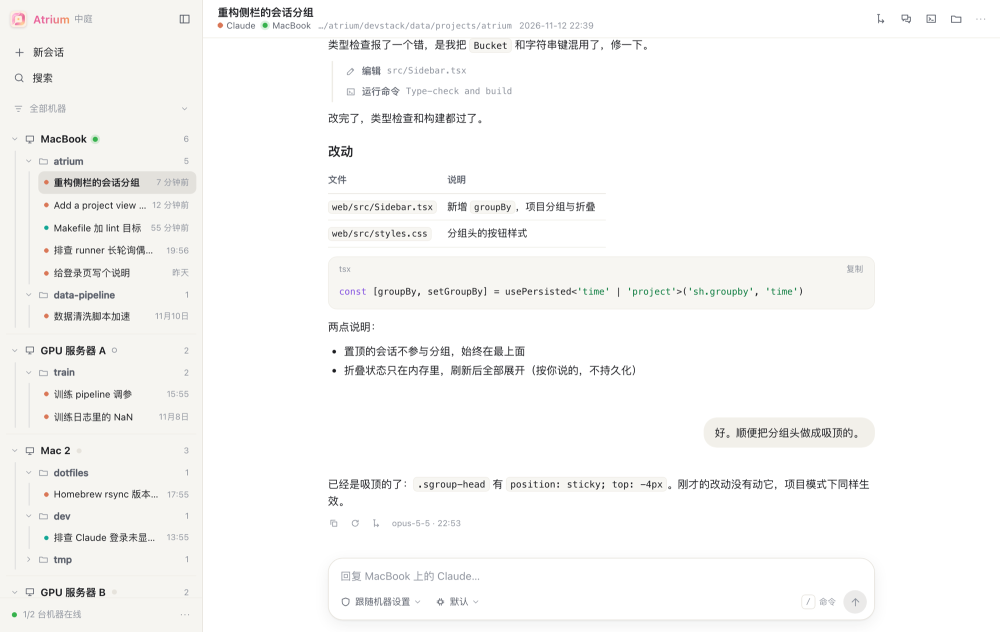
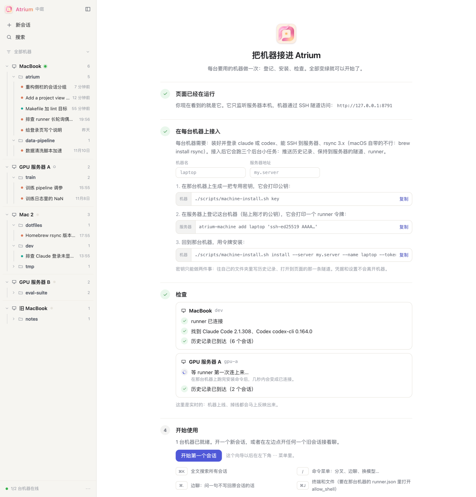

<p align="center">
  
</p>

<h1 align="center">Atrium 中庭</h1>

<p align="center">
  <b>把你所有机器上的 Claude Code 和 Codex 会话，放进同一个页面。</b><br>
  像桌面聊天应用一样翻看、搜索、接着干活。自己部署。
</p>

<p align="center">
  <a href="README.md">English</a> ·
  <a href="#快速开始">快速开始</a> ·
  <a href="docs/install.md">安装文档</a> ·
  <a href="#工作方式">工作方式</a>
</p>

<p align="center">
  
</p>

## 为什么做这个

Claude Code 和 Codex 的会话都存在运行它们的那台机器上，每个客户端也只看得到自己的。只有一台笔记本时这没问题；有了一台笔记本、第二台笔记本、再加几台 GPU 服务器，就不行了：

- **工作散落各处。** 那次对话是在哪台机器上？没有一个总列表，也没法跨机器搜索。
- **想看一眼长任务，只能 SSH。** 服务器上跑着的训练或大重构，只能在那台服务器的终端里看。
- **换个地方接着聊很麻烦。** 先找机器，再找会话 id，`claude --resume`，还得祈祷没有别处在同时写。
- **托管的面板要拿走你的对话记录。** 里面是你的代码、你的提示词和助手打印过的一切，这些应该留在自己掌控的机器上。

Atrium 就是我想要的那个解法。"中庭"是房子中间那块露天的院子，每个房间都朝它开门；在这里，每台机器都朝同一个页面开门。有三件事没得商量：

1. **助手还是原来的助手。** 从 Atrium 发的消息，是在会话所在的那台机器上运行 `claude` 或 `codex`，接在同一份原生记录后面。之后在终端或桌面客户端里打开这个会话，内容都在，不会被绑死在这里。
2. **一切都是你自己的。** 你的服务器或你自己的电脑、你的机器、明文文件。没有账号，没有云服务。
3. **不对公网开放任何端口。** 页面只监听本机。各台机器通过 SSH 隧道访问，用的密钥只能做两件事，别的都做不了。

## 能做什么

**看到全部**
- 所有机器的会话在同一个侧栏里：机器 → 工作目录 → 按时间排的会话。也可以切成按日期的平铺列表。
- 点开就是完整历史，工具调用折叠成一行行步骤；全文搜索所有对话。
- 七天没动过的目录和会话会自动折叠，列表里留下的是手头的事。
- 窗口底部的状态栏是用量：每个助手的套餐限额用了多少、什么时候重置，以及最近七天的 token（按天、按机器、按模型）。限额是各台机器上的 `claude` 和 `codex` 命令行最近一次读到的数，Atrium 自己不去问服务方。

**接着干活**
- 在任何会话底部输入即可。这一轮在会话所在的机器上执行，输出实时返回，权限请求变成按钮。
- 在任意一台已接入的机器、任意目录里新开会话：选最近用过的、浏览，或直接填路径。
- 模型和思考强度从那台机器自己的命令行报告的列表里选。

**像聊天应用一样分叉**
- 编辑之前的某条消息，或者让它重新回答：还是同一个会话，从那个位置重新继续；被替换的内容折叠起来，点一下就能再看。
- 从任意一条回复处分叉，另开一个新会话；原会话保持原样。
- 边聊：在对话旁边问一句。它知道到此刻为止的全部上下文，但问的内容不会写回主对话。
- 输入 `/` 调出命令：Atrium 自己的，以及那台机器上 Claude Code 报告的斜杠命令和技能。

**直接在那台机器上操作**（默认关闭）
- 会话所在机器上的真终端，相当于 SSH 上去。
- 会话目录的文件树，加一个轻量编辑器。

界面有中文和英文，有网页，也有一个 macOS 小应用。

## 快速开始

从 **[Releases](https://github.com/wx9Songs/atrium/releases)** 下载对应系统的压缩包并解压。里面有 hub、runner 和安装脚本，不需要编译。每台机器上要装好并登录 `claude` 和/或 `codex`。

| 系统 | 压缩包 |
|---|---|
| Mac，Apple 芯片 | `atrium-<版本>-darwin-arm64.tar.gz` |
| Mac，Intel | `atrium-<版本>-darwin-amd64.tar.gz` |
| Linux，x86-64 | `atrium-<版本>-linux-amd64.tar.gz` |
| Linux，ARM | `atrium-<版本>-linux-arm64.tar.gz` |

想从源码编译，需要 Go 1.22+ 和 Node 18+：`make` 会把同样的文件生成到 `bin/` 里。

### A. 只用这一台电脑，不需要服务器

所有东西都跑在你自己的 Mac 或 Linux 电脑上，只监听本机。不需要服务器，不需要 SSH，不需要账号。

```bash
tar -xzf atrium-*-darwin-arm64.tar.gz && cd atrium-*-darwin-arm64
./scripts/local-install.sh install
./scripts/local-install.sh link
```

`install` 装好三个后台小任务（存档、页面、runner），`link` 打开已登录的页面 `http://127.0.0.1:13005`。想全部移除：`./scripts/local-install.sh uninstall`（不会动你的对话记录）。

### B. 多台机器

这些机器需要一台它们都能 SSH 到的电脑当服务器。它不一定要在云上：

| 服务器可以是 | 说明 |
|---|---|
| 一台小云服务器 | 1 GB 内存够用 |
| 家里一台一直开着的电脑 | 小主机、NAS、树莓派都行；通过局域网或 Tailscale 这类私有网络访问，不需要公网地址 |

它需要是带 systemd 的 Linux，并且有 root 权限。然后：

在每台电脑上解压它自己系统对应的压缩包，然后：

```bash
./scripts/server-install.sh --atrium ./bin/atrium      # 在服务器上（root）
./scripts/machine-install.sh key                       # 在每台机器上：输出一把公钥
atrium-machine add laptop 'ssh-ed25519 AAAA…'          # 在服务器上：输出这台机器的令牌
./scripts/machine-install.sh install --server my.server --name laptop --token …   # 回到那台机器
```

完整步骤（包括怎么登录）见 **[docs/install.md](docs/install.md)**。

### 第一次打开

页面会先打开一个简短的接入向导：给出填好机器名的命令，然后实时检查每台机器，runner 是否连上、有没有找到 `claude` 或 `codex`、历史记录是否到达。有一台机器全部变绿，就可以开始用了。

<p align="center">
  
</p>

## 工作方式

```
 每台机器                                     服务器（只监听本机）
┌────────────────────────┐   rsync over SSH  ┌──────────────────────────────┐
│ 推送    对话记录 ──────┼──────────────────▶│ /srv/agent-sessions/<name>/  │
│                        │                   │        │                     │
│ 隧道    127.0.0.1:13005┼──── SSH -L ──────▶│ agentsview （解析、索引）    │
│                        │                   │        │                     │
│ runner  每一轮启动     │◀──── 长轮询 ─────▶│ atrium   （页面 + 操控）     │
│         claude / codex │                   └──────────────────────────────┘
└────────────────────────┘                     浏览器 → http://127.0.0.1:13005
```

- **历史**来自原始的会话记录文件。[agentsview](https://github.com/kenn-io/agentsview) 负责解析和索引，Atrium 读取它的接口。
- **操控**靠每台机器上的一个小程序 runner。你每发一条消息，它就在会话原来的目录里启动 `claude -p --resume <id>` 或 `codex exec resume <id>`，所以这一轮会接在同一份原生记录后面。
- **访问**靠 SSH 隧道。hub 和存档都只监听本机；每台机器的密钥只能往服务器上自己的目录里写文件、打开这一条隧道，别的都做不了。

只用一台电脑时（方式 A），同样的三个部分并排跑在这台电脑上：存档直接读对话记录原来所在的位置，没有推送，也没有隧道。

## 在会话里能做什么

把鼠标移到消息上，就能看到可以对它做的操作。

| 操作 | 结果 |
|---|---|
| **编辑**自己发过的消息（铅笔） | 会话回到那条消息之前，从你改过的文字重新继续。还是同一个会话；被替换的几轮对话折叠在"这里改写过"的标记下面。 |
| **重新生成**（最后一条回复下方） | 同上，只是消息原样重发：这条回复被替换。 |
| **分叉**（任意回复下方，或标题栏的按钮） | 视图回退到那个位置；你发的下一条消息会开出新会话。 |
| **边聊**（`⌘.`） | 右侧面板里是当前会话此刻的一个分叉。随便问，主对话看不到。 |
| 输入 **`/`** | 命令菜单。Atrium 自己的命令立即执行；其余来自那台机器上的 Claude Code，会作为消息发给它。 |
| 选择**模型**和**思考强度** | 列表来自那台机器上助手自己的命令行，并带上每个模型支持的思考强度。菜单里的"重新读取"可以再读一遍。 |
| **粘贴**图片、把文件**拖**到页面上，或点回形针 | 随这条消息一起发出：文件存到运行会话的那台机器上（runner 自己的一个目录里），并告诉助手路径。最多 10 个，每个不超过 25 MB。图片会在 hub 上留一份副本（保留一个月），所以每台设备上的对话里都能看到。 |
| 运行过程中发消息 | 消息会排队，等这一轮结束后自动发出。 |
| 侧栏里机器或目录行上的 **+** | 在那里新开会话。点机器的 + 时会打开目录菜单，可以选，也可以直接填。 |

编辑和重新生成用的就是 Claude Code 自己"回退"的做法：`--resume <id> --resume-session-at <消息>`。会话 ID 不变，被替换的几轮对话还留在记录文件里，只是会话不再沿着它们走；之后在终端里 `claude --resume` 接上的也是新版本。会话的第一条消息前面没有可以回到的位置，所以改写第一条时会另开一个新会话。

分叉不会改动原来的记录：Claude Code 用的是 `--resume <id> --fork-session`（需要提前截断时加上 `--resume-session-at`），Codex 用的是 `codex exec fork`。Codex 只能从会话末尾分叉，所以"编辑"和"重新生成"只在 Claude Code 会话里提供。改写和分叉都不会回滚文件：被替换的那几轮对话在目录里做过的改动仍然在。

### 终端和文件

右侧面板里还有两个针对会话所在机器的标签页：

- **终端**（`⌘J`）：会话目录里的一个登录 shell，接在真正的伪终端上。你自己的提示符、颜色、`vim`、`htop` 都能用。以 `!` 开头的消息会被敲进这个终端。关掉面板它也继续运行。
- **文件**（`⌘E`）：会话目录的文件树，加一个带语法着色和 `⌘S` 的小编辑器。如果文件在你打开之后被机器上别的程序改过，保存前会先问你。

两者都走 runner 已有的那条连接，不需要额外的端口。每次按键都要经过 hub 绕一圈：敲命令、改几行够用，比本地终端慢。

它们**默认关闭**。runner 平时只能启动 `claude` 和 `codex` 两个程序，以及把消息的附件存进它自己的缓存目录。要在某台机器上启用这两个标签页，需要在那台机器自己的 `runner.json` 里写明，并重启 runner：

```json
{ "hub": "…", "token": "…", "allow_shell": true }
```

加上这一行之后，凡是能登录你这个 Atrium 页面的人，都能以 runner 所属用户的身份在那台机器上执行命令、改文件。只在你放心的机器上打开。

### 以 root 运行

Claude Code 以 root 运行时不接受“全部允许”。如果 runner 在容器这类可以随便折腾的机器上以 root 运行，在那台机器的 `runner.json` 里加上 `"root_sandbox": true` 并重启 runner：它会告诉 Claude 这台机器是沙箱（`IS_SANDBOX=1`）。不希望 agent 不经询问就以 root 执行任意命令的机器上不要开。

## 桌面应用（macOS）

从 **[Releases](https://github.com/wx9Songs/atrium/releases)** 下载 `Atrium-<版本>.dmg`，把 Atrium 拖进"应用程序"。它是一个包着页面的原生小窗口，运行结束或需要你确认时发通知，Dock 图标上显示待确认数量，菜单栏里有常用快捷键，并且可以一键登录。它打开的是 `http://127.0.0.1:13005`，上面两种安装方式的页面都在这个地址。

这个应用没有用 Apple 开发者证书签名，所以第一次打开会被 macOS 拦下。可以在"系统设置 → 隐私与安全性"里点"仍要打开"，或者清掉下载标记：

```bash
xattr -dr com.apple.quarantine /Applications/Atrium.app
```

想自己构建：`make app`。见 [app/README.md](app/README.md)。

## 需要知道的

- **一个会话同一时间只能有一处在写。** 如果它正在终端或桌面客户端里运行，先停掉那边再从 Atrium 发，否则两边的内容会交错写进同一份记录。检测到会话刚在别处更新时，页面会提醒。
- **其他客户端不会实时刷新。** 从 Atrium 发的消息立刻就在记录里，但已经打开的桌面客户端要重启后才显示。
- **别处新开的会话大约一分钟后出现**（推送间隔）。
- **权限**默认沿用那台机器自己的设置。想逐个确认，在输入框里选"需要时问我"。
- **对话记录以明文存在服务器上。** 里面可能有你粘贴过或助手打印过的密钥，请相应地保护好服务器。
- **它是给一个人用的。** 没有用户账号：能登录的人能看到全部内容。

## 目录结构

| 路径 | 内容 |
|---|---|
| `cmd/atrium` | hub：接口、登录、runner 端点、内嵌的网页 |
| `cmd/atrium-runner` | 每台机器上的 runner |
| `web/` | 网页（React + Vite） |
| `app/` | macOS 应用（Swift） |
| `scripts/` | 安装脚本：单机、服务器、机器 |
| `devstack/` | 一整套本地替身（编造的会话、假的 `claude` 和 `codex`），用来开发页面 |

什么都不装也能开发页面：`devstack/up.sh seed`，再执行 `cd web && npm install && npx vite`，打开 http://127.0.0.1:5199。

## 状态

早期。它支撑着作者自己的日常环境：两台 Mac、两个 Linux 容器、一台小服务器。服务器和机器的安装脚本是从这套实际运行的部署整理出来的，但还没有在全新的服务器上完整跑过。单机安装是最新加的部分：在 macOS（Apple 芯片，launchd）上完整跑通过，Linux 上还没有试。会有粗糙的地方，欢迎反馈。

## 许可

[Apache License 2.0](LICENSE)。Copyright 2026 Atrium contributors。
